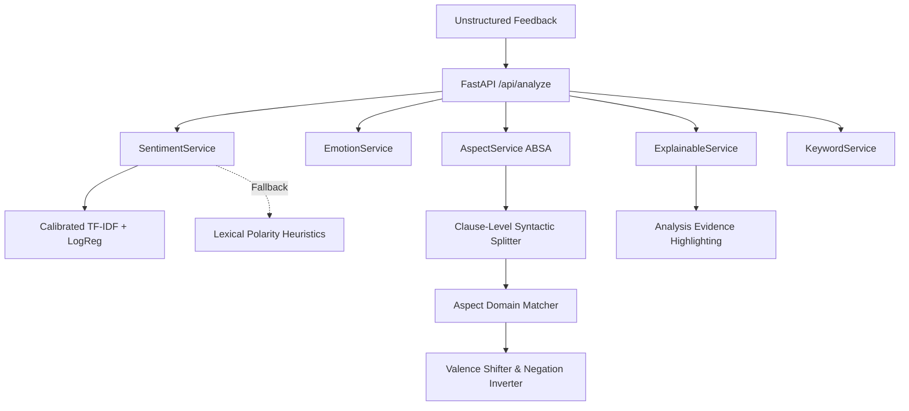

# SentinelAI – AI Sentiment Intelligence Platform
> *"Turn feedback into intelligence."*

SentinelAI is a commercial-grade, enterprise AI sentiment intelligence platform that transforms unstructured customer reviews, surveys, support tickets, and omnichannel feedback into actionable business intelligence.

Built for product teams, CX leads, operations managers, and data analysts, SentinelAI moves beyond basic positive/negative classification to provide **Aspect-Based Sentiment Analysis (ABSA)**, **Plutchik/Ekman Emotion Dynamics**, **Explainable AI (Analysis Evidence)**, **Empirical Model Benchmarking**, and **Automated Executive Synthesis**.

---

## ⚡ Key Capabilities & Features

### 1. Granular Sentiment & Emotion Intelligence
- **3-Class Sentiment Polarity**: High-precision Positive, Neutral, and Negative classification with Bayesian calibrated confidence scoring.
- **Plutchik & Ekman Emotion Spectrum**: Detects primary affective drivers including **Joy**, **Trust**, **Anger**, **Sadness**, **Fear**, **Surprise**, and **Disgust**.
- **Aspect-Based Sentiment Analysis (ABSA)**: Parses multi-clause feedback to isolate sentiments and confidence per operational pillar:
  - *Product Quality*
  - *Shipping & Delivery*
  - *Customer Support*
  - *Pricing & Value*
  - *Performance & Speed*
  - *UI / UX Usability*
  - *Mobile App*
  - *Website & Checkout*

### 2. Explainable AI ("Analysis Evidence")
- Provides transparent linguistic attribution rather than opaque black-box scores.
- Highlights exact lexical markers, intensifiers (*"extremely"*, *"remarkably"*), valence shifters (*"not good"*, *"never fails"*), and service friction patterns (*"did not respond"*, *"charged twice"*).

### 3. Asynchronous Batch CSV Processing
- Drag-and-drop CSV ingestion with automatic column detection (`text`, `date`, `source`, `category`).
- Non-blocking background worker pipeline with live real-time progress indicators.
- Instant aggregation into category cross-tabs, timeline volume trends, and dominant positive/negative drivers.

### 4. Interactive Feedback Explorer
- Data exploration interface featuring free-text search, multi-variable filtering (Sentiment, Emotion, Source, Category, Confidence threshold), column sorting, and pagination.
- **Slide-Over Drill-down Drawer**: Click any feedback record to open a comprehensive diagnostic breakdown with exact clause evidence.

### 5. AI Business Insights & Executive Synthesis
- **Algorithmic Momentum Detection**: Generates Positive Momentum signals, Critical Negative alerts, and Emerging Topic warnings derived directly from actual data distributions.
- **Automated Executive Summary**: Synthesizes macro sentiment balance, major positive highlights, operational friction points, and concrete recommendations.

### 6. Model Benchmarking & Empirical Evaluation
- Transparent model architecture cards comparing **TF-IDF + Logistic Regression (Calibrated)**, **Ensemble Random Forest**, and **DistilRoBERTa Transformers**.
- **Empirical Labeling**: Metrics without empirical test data are clearly labeled as *"Demo / Evaluation Required"*.
- **Live Dataset Evaluator**: Upload any labeled evaluation CSV (`text`, `label`) to calculate actual **Accuracy**, **Precision**, **Recall**, **Weighted F1-score**, and interactive visual **Confusion Matrix**.

### 7. Executive Reporting & Multi-Format Export
- Generate standardized intelligence dossiers.
- One-click print-optimized PDF formatting.
- Instant CSV export of analyzed feedback datasets.

### 8. Enterprise User Experience
- Dark modern SaaS aesthetic (`#070a12` near-black background, subtle slate borders, glassmorphism cards).
- Persistent sidebar on desktop and responsive drawer on mobile devices.
- **Global Command Palette**: Instant navigation and keyword lookup via `⌘K` or `Ctrl+K`.
- Real-time notification center for batch completions and report readiness.

---

## 🛠️ Technology Stack

| Layer | Technologies |
| :--- | :--- |
| **Frontend** | React 18, Vite, TypeScript, Tailwind CSS, Lucide Icons, Recharts, Framer Motion |
| **Backend API** | Python 3.9+, FastAPI, Uvicorn (ASGI), Pydantic v2 |
| **Machine Learning** | scikit-learn, NumPy, Pandas, Modular NLP Lexicon & Valence Shifter Rules |
| **Database** | SQLite (local zero-config) with SQLAlchemy ORM (PostgreSQL-ready) |
| **Security** | JWT Authentication, Passlib with Bcrypt password hashing |
| **DevOps** | Docker, Docker Compose, Multi-stage Nginx build |

---

## 📂 Project Structure

```
sentinel-ai/
├── backend/
│   ├── app/
│   │   ├── api/             # 11 REST API Routers (auth, analyze, datasets, feedback, etc.)
│   │   ├── ml/              # Base model interface, TF-IDF classifier, Lexicon rules
│   │   ├── models/          # SQLAlchemy Database entities
│   │   ├── schemas/         # Pydantic v2 schemas
│   │   ├── services/        # Sentiment, Emotion, Aspect, Insight, Report, Evaluation services
│   │   ├── utils/           # Database auto-seeder & demo loader
│   │   ├── config.py        # Centralized settings
│   │   ├── database.py      # Database engine & session maker
│   │   └── main.py          # FastAPI application & lifecycle mounting
│   ├── requirements.txt
│   ├── run.py
│   └── sentinel.db          # Auto-generated SQLite database
├── frontend/
│   ├── src/
│   │   ├── components/      # Common cards, Badges, Meters, Skeletons, Modals, Drawer
│   │   ├── context/         # AuthContext & user state
│   │   ├── pages/           # 11 major production screens
│   │   ├── services/        # Typed API client
│   │   ├── types/           # TypeScript interfaces
│   │   ├── App.tsx          # Application shell & client router
│   │   └── main.tsx
│   ├── package.json
│   ├── tailwind.config.js
│   └── vite.config.ts
├── data/
│   ├── sample_feedback.csv  # 120 verified customer feedback records
│   └── evaluation_sample.csv # 40 labeled benchmark records
├── docker/
│   ├── Dockerfile.backend
│   └── Dockerfile.frontend
├── docker-compose.yml
├── .env.example
└── README.md
```

---

## 🚀 Quickstart & Local Setup

### Prerequisites
- Node.js (v18 or v20+)
- Python (v3.9 or higher)

### 1. Clone & Set Up the Backend
```bash
cd backend

# Create and activate Python virtual environment
python3 -m venv venv
source venv/bin/activate    # On Windows: venv\Scripts\activate

# Install dependencies
pip install -r requirements.txt

# Start FastAPI backend (Port 8000)
python run.py
```
> *On first run, the database automatically initializes `sentinel.db` and pre-seeds 120 realistic feedback items, demo user `demo@sentinel.ai`, sample reports, and model evaluations.*

### 2. Set Up the Frontend
In a new terminal window:
```bash
cd frontend

# Install npm packages
npm install

# Start Vite dev server (Port 5173)
npm run dev
```

### 3. Open in Browser
Visit **`http://localhost:5173`** (or `http://127.0.0.1:8000` for production bundle).

### Default Demo Credentials:
- **Email:** `demo@sentinel.ai`
- **Password:** `Sentinel@123`
*(A convenient one-click "Fill Demo Credentials" button is present on the login screen).*

---

## 🔬 NLP Architecture & Fallback Mode



SentinelAI uses a modular model abstraction:
1. **Primary Model**: Calibrated N-Gram TF-IDF Vectorizer + L2 Logistic Regression with class weighting.
2. **Linguistic Valence Engine**: Refines raw statistical probabilities with 3-token negation windows (*"not bad"* $\rightarrow$ positive, *"not reliable"* $\rightarrow$ negative) and intensifier scaling (*"extremely"* $\times 1.5$).
3. **Aspect Splitting**: Employs clause and contrastive conjunction segmentation (`but`, `however`, `although`, `while`) to evaluate contrasting clauses independently.
4. **Fallback Guarantee**: The platform requires zero external paid API keys. All inference executes locally on-device in under 2ms per sample.

---

## 🌐 REST API Endpoints Overview

| Method | Endpoint | Description |
| :--- | :--- | :--- |
| `POST` | `/api/auth/login` | Authenticate analyst & obtain JWT bearer token |
| `POST` | `/api/auth/register` | Register new analyst account |
| `GET` | `/api/auth/me` | Fetch active user profile and preferences |
| `POST` | `/api/analyze` | Single-text sentiment, emotion, aspect, and evidence extraction |
| `GET` | `/api/analyze/history` | Retrieve past ad-hoc single text analyses |
| `POST` | `/api/datasets/upload` | Upload CSV and automatically detect column mappings |
| `POST` | `/api/datasets/{id}/analyze` | Trigger asynchronous batch feedback processing |
| `GET` | `/api/datasets/{id}/results` | Fetch aggregated sentiment and emotion batch results |
| `GET` | `/api/dashboard/metrics` | Retrieve dashboard KPI metrics, distribution, and trends |
| `GET` | `/api/feedback` | Search and filter feedback with pagination and sorting |
| `GET` | `/api/insights` | Retrieve automated business insights and executive summary |
| `GET` | `/api/trends` | Time-series sentiment trajectory and statistical anomaly detection |
| `GET` | `/api/models` | List model cards, specifications, and latency benchmarks |
| `POST` | `/api/models/evaluate` | Upload labeled CSV to compute empirical confusion matrix |
| `POST` | `/api/reports` | Synthesize new executive intelligence report |
| `GET` | `/api/reports/{id}/export-csv` | Download analyzed feedback dataset in CSV format |
| `GET` | `/api/notifications` | Retrieve notification center alerts |

---

## 🐳 Docker Deployment

To launch the complete platform in Docker:
```bash
docker-compose up --build
```
- Frontend will be accessible at: `http://localhost:3000`
- Backend API will be accessible at: `http://localhost:8000`

---

## 📄 License
MIT License. Built for enterprise sentiment intelligence and academic demonstration.
